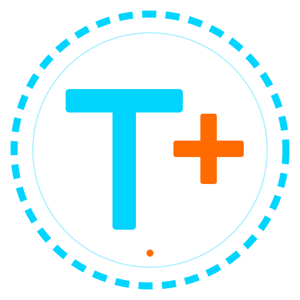
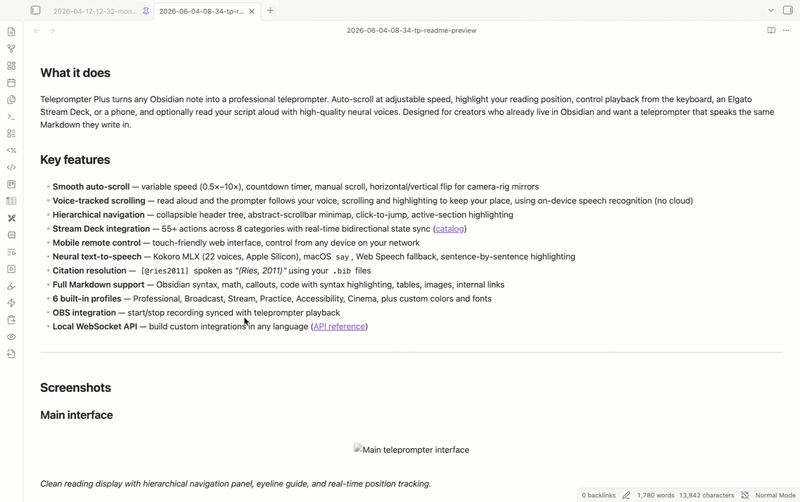
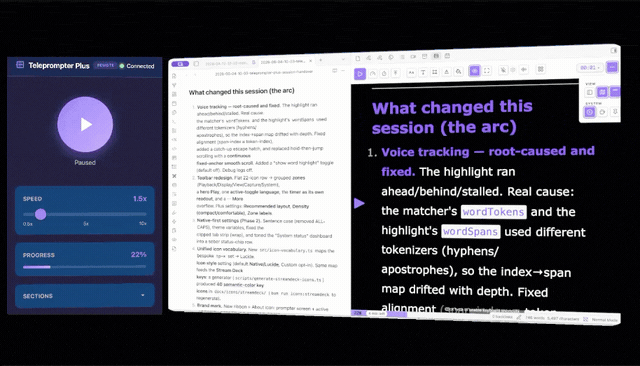
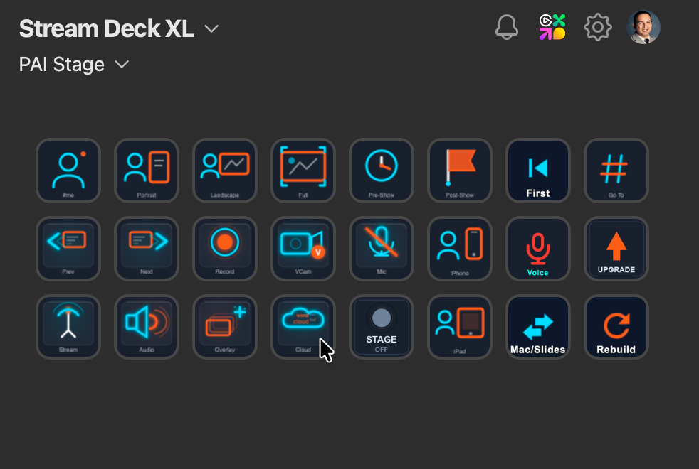
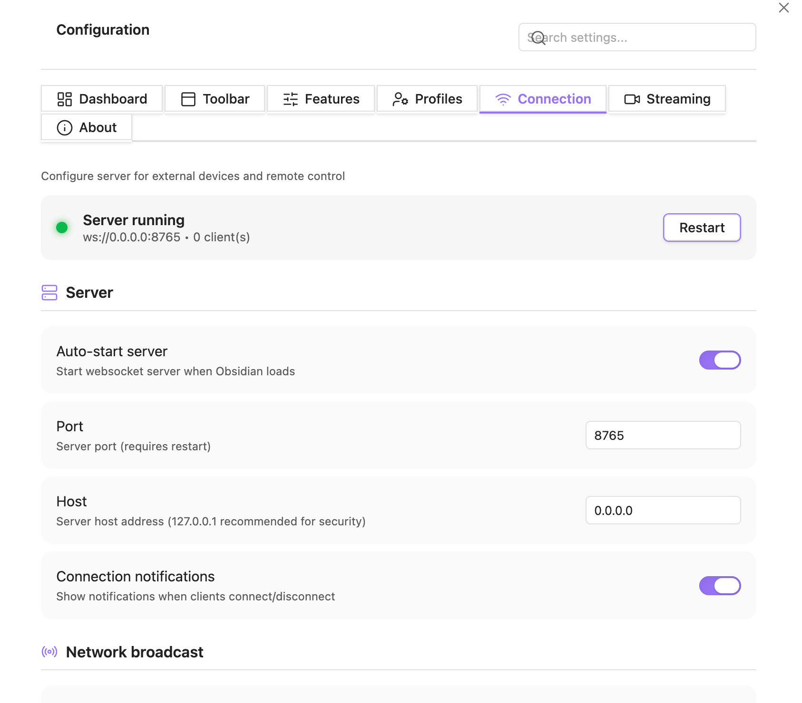
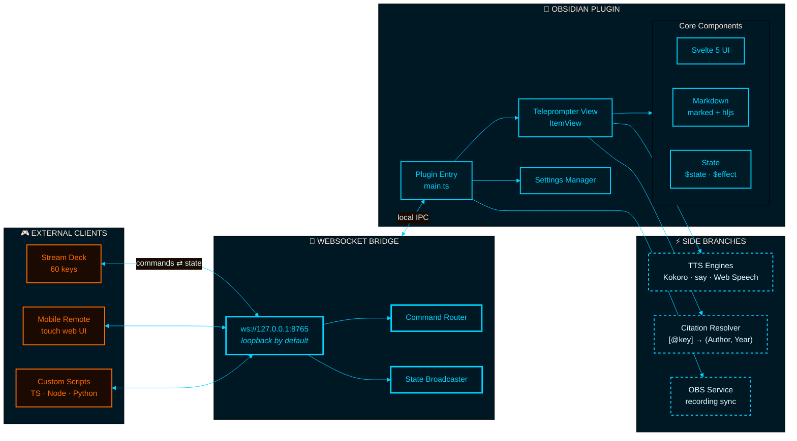

<p align="center">
  
</p>

# Teleprompter Plus

<p align="center"><strong>Professional teleprompter for Obsidian — Stream Deck hardware control, mobile remote, neural text-to-speech, and full Markdown support.</strong></p>

<p align="center">
  <a href="https://github.com/JuracyAmerico/obsidian-teleprompter-plus/releases/latest">
    
  </a>
  
  
  <a href="https://ko-fi.com/americocanada">
    
  </a>
</p>

<p align="center">Built for video recording, presentations, podcasts, speeches, and content creation.</p>

---

## What it does

Teleprompter Plus turns any Obsidian note into a professional teleprompter. Auto-scroll at adjustable speed, highlight your reading position, control playback from the keyboard, an Elgato Stream Deck, or a phone, and optionally read your script aloud with high-quality neural voices. Designed for creators who already live in Obsidian and want a teleprompter that speaks the same Markdown they write in.

## Key features

- **Smooth auto-scroll** — variable speed (0.5×–10×), countdown timer, manual scroll, horizontal/vertical flip for camera-rig mirrors
- **Voice-tracked scrolling** — read aloud and the prompter follows your voice, scrolling and highlighting to keep your place, using on-device speech recognition (no cloud)
- **English and Portuguese voice** — the prompter listens in the language of each script, or set `voice-language` in a note's properties. Recognition stays on your computer: Apple's on-device speech when macOS offers it for that language, otherwise an offline Vosk model, downloaded once.
- **Floating window** — keep the script on top of a video call, with adjustable see-through and a lock that lets clicks pass to the app underneath. With an Elgato Prompter connected, it opens there and fills the screen with just the script. **Check what you share:** in a Zoom test on macOS, the script showed when sharing the entire screen it was on and when sharing an Obsidian window. It did not show when sharing another app's window, or a screen it was not on. Share another app's window, or keep the script on a Prompter or second display.
- **Hierarchical navigation** — collapsible header tree, abstract-scrollbar minimap, click-to-jump, active-section highlighting
- **Stream Deck integration** — 60 keys with real-time bidirectional state sync, including a rehearsal clock and voice tracking ([catalog](docs/stream-deck-actions.md))
- **Mobile remote control** — touch-friendly web interface, control from any device on your network, protected by a remote key ([setup](#phone-remote))
- **Rehearsal takes** — give a section a target time, `## Why us {1:30}`, and get your time against it when you finish ([how it works](#takes-and-targets))
- **Neural text-to-speech** — ElevenLabs (cloud, opt-in, bring-your-own-key), Kokoro MLX (22 local voices, Apple Silicon), macOS `say`, Web Speech fallback, sentence-by-sentence highlighting
- **Citation resolution** — `[@ries2011]` spoken as *"(Ries, 2011)"* using your `.bib` files
- **Full Markdown support** — Obsidian syntax, math, callouts, code with syntax highlighting, tables, images, internal links
- **6 built-in profiles** — Professional, Broadcast, Stream, Practice, Accessibility, Cinema, plus custom colors and fonts
- **OBS integration** — start/stop recording synced with teleprompter playback
- **Local WebSocket API** — build custom integrations in any language ([API reference](docs/websocket-api.md))

---

## Screenshots

### Main interface

<p align="center">
  
</p>

*Clean reading display with hierarchical navigation panel, eyeline guide, and real-time position tracking.*

### Mobile remote

<p align="center">
  
</p>

*Touch-friendly remote — phone, tablet, or second computer on the same network.*

### Stream Deck

<p align="center">
  
</p>

*60 hardware keys with live state synchronization across all controls.*

### Settings

<p align="center">
  
</p>

*Seven-tab settings: Dashboard, Toolbar, Features, Profiles, Connection, Streaming, About.*

---

## Installation

### Community Plugin browser (recommended once published)

Obsidian → Settings → Community plugins → Browse → search **Teleprompter Plus** → Install → Enable.

### Manual install

1. Download `main.js`, `styles.css`, and `manifest.json` from the [latest release](https://github.com/JuracyAmerico/obsidian-teleprompter-plus/releases/latest).
2. Place them in `<your-vault>/.obsidian/plugins/teleprompter-plus/` (create the folder if needed).
3. Obsidian → Settings → Community plugins → Reload → enable **Teleprompter Plus**.

### Build from source

```bash
git clone https://github.com/JuracyAmerico/obsidian-teleprompter-plus.git
cd obsidian-teleprompter-plus
bun install
bun run build
# copy dist/main.js, dist/styles.css, and manifest.json into your vault's plugins folder
```

See [CONTRIBUTING.md](CONTRIBUTING.md) for the full development setup.

---

## Quick start

1. **Open** — click the teleprompter ribbon icon, or run *Open Teleprompter Plus* from the command palette (`Cmd/Ctrl + P`).
2. **Pick a note** — the active note loads when you open the view, and reloads when you switch notes or reopen the view. It does not follow your edits as you type.
3. **Play** — click Play (or press your hotkey). Adjust speed with `+` / `−`, font size with `Aa+` / `Aa−`.
4. **Navigate** — click any header in the side panel to jump there. Click the minimap on the right to scrub.
5. **Reset** — Reset returns to the top.

For 25+ keyboard commands, see Obsidian → Settings → Hotkeys → Teleprompter Plus.

**Pedals and clickers:** PageDown and PageUp turn a page. If your pedal sends arrow keys, turn on "Arrow keys turn pages" in settings. Keys work only while the prompter has focus, so over a video call use the Stream Deck or the phone remote. An Elgato Stream Deck Pedal is a Stream Deck device: assign the Scroll Up, Scroll Down or Next Section actions to it in the Stream Deck app, and they work without focus.

**Hiding the floating window from a screen share:** the bar's "Hide from capture" box asks macOS to leave that window out of screen capture. We measured entire-screen shares on macOS 26.5 in Zoom 7.1.9 (local recording), Google Meet in Chrome 156 (the outgoing stream) and Microsoft Teams 26289 (a second participant's view): with the box on the floating window was absent, while other windows on that screen still showed. That is one Mac on one day, so test your own setup before relying on it. It also blanks the window in your own screenshots and recordings.

**While you work on a script:** saving the note updates the prompter in place, your place and voice tracking included. Double-click a word to jump to its line in the note. If you go back and read an earlier line again, voice tracking moves back to it after about six words. Each note reopens where you left it, and one you read to the end starts from the top. Notes to yourself in square brackets, such as `[pause]`, are hidden on screen, never read aloud and never tracked; a setting shows them dimmed instead. With "Keep screen awake while reading" on, the screen stays awake while the script plays, voice listens or it reads aloud.

---

## Takes and targets

Rehearse a script against the clock, section by section.

- **Give a section a target** in its heading: `## Why us {1:30}`. `{90s}` and `{2m}` work too. The braces never show on the prompter and are never read aloud.
- **Finish the section and read your take.** Playback pauses and a card shows your time against the target, like "Why us · 1:42 · target 1:30 · +0:12". It appears in the main window, on the floating script and on the phone remote. Settings → Features → Display → *Stop at the end of a section* chooses when playback pauses: only at sections with a target (the default), at every section, or never.
- **Show recent takes** (command palette) lists your last 20 takes of the note, newest first, with the best one for each section marked.
- **Fit to target** sits next to the speed control, which also shows your speed in words per minute. One click sets the speed so the rest of the section, or the script, ends on its target. If that speed is outside your speed limits it stops at the limit and says so.

Takes are kept in `takes.json` in the plugin's own folder, up to 5,000 of them. The plugin sends the file nowhere, but it sits inside the vault's `.obsidian` folder, so a vault sync carries it too.

---

## Phone remote

Control the prompter from a phone or tablet on the same Wi-Fi.

1. In Obsidian, Settings → Teleprompter Plus → Connection → Server, set **Host** to `0.0.0.0`, then click **Restart**. The default, `127.0.0.1`, reaches only this computer.
2. Under **Remote interface**, copy the link. It ends in `?key=…`: that is the **remote key**, made for your install on first start. Open the whole link in the phone's browser.
3. Anything on your network without the key gets `401` and cannot send commands; the Stream Deck on this computer needs no key. Updating from before 0.12.10: open the new link once.

The link is plain `http://`, not encrypted: use it on a network you trust. If the link shows an address that is not your Wi-Fi address (a VPN or Tailscale address), swap in your computer's LAN address and keep `?key=`: Tailscale (`100.x`), `.local` and MagicDNS names are refused. What the server accepts and what protects it: [ATTACKSURFACE.md](ATTACKSURFACE.md).

---

## Settings overview

| Tab | What's there |
|-----|--------------|
| **Dashboard** | Live preview, quick profile picker, health status |
| **Toolbar** | Choose which controls appear in the teleprompter toolbar |
| **Features** | Collapsible cards by category — appearance, playback, navigation, voice, OBS, WebSocket |
| **Profiles** | 6 built-in profiles + your own saved configurations |
| **Connection** | Optional local WebSocket server for Stream Deck + mobile remote; the remote link and key |
| **Streaming** | OBS connection and recording sync |
| **About** | Plugin info, shortcuts, credits |

---

## Stream Deck

60 keys in 10 groups — Playback, Speed, Text size and spacing, Colors and fonts, Navigation, Display and window, Countdown, Rehearsal clock, Voice tracking, OBS. Real-time bidirectional state sync: the Stream Deck button updates live when you change the teleprompter from any source.

```json
{ "command": "toggle-play" }
{ "command": "set-speed", "speed": 3 }
{ "command": "jump-to-header", "index": 1 }
```

Full action catalog, configuration steps, and Stream Deck plugin setup: **[docs/stream-deck-actions.md](docs/stream-deck-actions.md)**.

---

## WebSocket API

A local-only WebSocket server (default `ws://127.0.0.1:8765`) lets you build custom controls in any language.

```typescript
const ws = new WebSocket('ws://127.0.0.1:8765')

ws.onopen = () => ws.send(JSON.stringify({ command: 'play' }))

ws.onmessage = (e) => {
  const msg = JSON.parse(e.data as string)
  if (msg.type === 'state') console.log('speed:', msg.data.speed)
}
```

Every command with its parameters, the state shape, and integration examples: **[docs/websocket-api.md](docs/websocket-api.md)**.

> **Privacy** — by default the server binds to `127.0.0.1`, so only this computer can reach it. The phone remote needs the host set to `0.0.0.0` ([Phone remote](#phone-remote)): from then on any device on your network can reach the port, everything except `/health` needs the remote key, and the traffic is not encrypted. See [ATTACKSURFACE.md](ATTACKSURFACE.md).

---

## Text-to-Speech

Three offline engines, selected automatically based on availability, plus one optional cloud engine:

1. **Kokoro MLX** *(best quality, Apple Silicon)* — 22 voice presets (male/female, American/British English), audio-synced scrolling, sentence-by-sentence highlighting. See [docs/tts-setup.md](docs/tts-setup.md) for the one-time Python venv install.
2. **macOS `say`** — built-in system voices (Samantha, Daniel, etc.). No setup.
3. **Web Speech API** — universal fallback. Quality varies by OS and browser engine.
4. **ElevenLabs** *(optional, cloud, paid — bring your own key)* — high-quality neural voices via the ElevenLabs API. Off by default and never auto-selected; choose it explicitly in settings and paste your own API key. See the privacy note below.

Pause/resume from the toolbar or keyboard. Citations are resolved from your bibliography (Quarto/Pandoc `.bib` files).

### Network use & privacy

All default engines run **fully offline** — no audio or text leaves your machine. The **ElevenLabs** engine is the one exception and is strictly opt-in: when you explicitly select it and provide your own API key, the text of the script you are reading is sent to ElevenLabs' servers to synthesize audio, and playback consumes credits on **your** ElevenLabs account. No key is bundled with the plugin, and nothing is sent to ElevenLabs unless you turn the engine on. Prefer to keep everything local and free? Use Kokoro, macOS `say`, or Web Speech.

---

## Troubleshooting

Most common issues:

| Issue | Fix |
|-------|-----|
| **WebSocket port already in use** | Settings → Connection → change port (default `8765`), then click *Restart*. The Stream Deck plugin only connects to `8765`, so keep it if you use the deck. |
| **Stream Deck not connecting** | Settings → Connection → *Restart*. Confirm the Stream Deck plugin is installed and the port is `8765`. |
| **Plugin doesn't appear after install** | Verify `<vault>/.obsidian/plugins/teleprompter-plus/` contains `main.js`, `styles.css`, `manifest.json`. Reload Obsidian (`Cmd/Ctrl + R`). |
| **Content not updating when switching notes** | Close and reopen the teleprompter view. |
| **Fullscreen looks wrong** | Plugin fullscreen is in-window. For true OS fullscreen, use Obsidian's *View → Toggle Fullscreen* first. |

Full troubleshooting guide: **[docs/troubleshooting.md](docs/troubleshooting.md)**.

---

## Architecture



> Orange = command sent from a client. Cyan = state update broadcast back. By default all traffic stays on `127.0.0.1`; with the host set to `0.0.0.0` for the phone remote, the phone connects over your LAN with the remote key.

A richer Excalidraw version of this diagram is in **[docs/architecture.excalidraw](docs/architecture.excalidraw)** — open it in Obsidian (with the Excalidraw plugin) to view, edit, or export to PNG/SVG for slides and presentations.

Design system, component reference, and icon catalog: **[docs/](docs/)**.

---

## Contributing

Pull requests welcome. See **[CONTRIBUTING.md](CONTRIBUTING.md)** for the tech stack, project structure, build workflow, code style, and contribution guidelines.

---

## Changelog & roadmap

Full version history in **[CHANGELOG.md](CHANGELOG.md)**. Latest release: see the [Releases page](https://github.com/JuracyAmerico/obsidian-teleprompter-plus/releases).

Have an idea? [Open a discussion](https://github.com/JuracyAmerico/obsidian-teleprompter-plus/discussions) or [submit an issue](https://github.com/JuracyAmerico/obsidian-teleprompter-plus/issues).

---

## Credits & license

Created by **Americo** ([@JuracyAmerico](https://github.com/JuracyAmerico)).

Built with [Obsidian](https://obsidian.md), [Svelte 5](https://svelte.dev), [TypeScript](https://www.typescriptlang.org), [Vite](https://vitejs.dev), [marked.js](https://marked.js.org), [highlight.js](https://highlightjs.org), and [ws](https://github.com/websockets/ws).

### Acknowledgements

The voice-tracking matcher (speech-to-script alignment) is **ported from
[jlecomte/voice-activated-teleprompter](https://github.com/jlecomte/voice-activated-teleprompter)**
(MIT) — its Levenshtein look-ahead algorithm and tokenizer are the basis for
`src/voice/speech-matcher.ts`, `word-tokenizer.ts`, and `levenshtein.ts`, with the
edit-distance core from [js-levenshtein](https://github.com/gustf/js-levenshtein) (MIT).
Thank you to those projects.

MIT License. Copyright © 2024–2026 Juracy Américo. See [LICENSE](LICENSE).

### Support

If this plugin saves you time, you can support continued development:

<p align="center">
  <a href="https://ko-fi.com/americocanada">
    
  </a>
</p>
