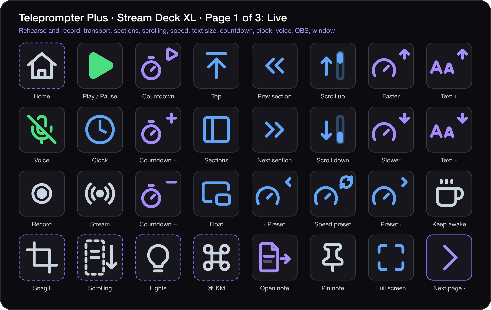
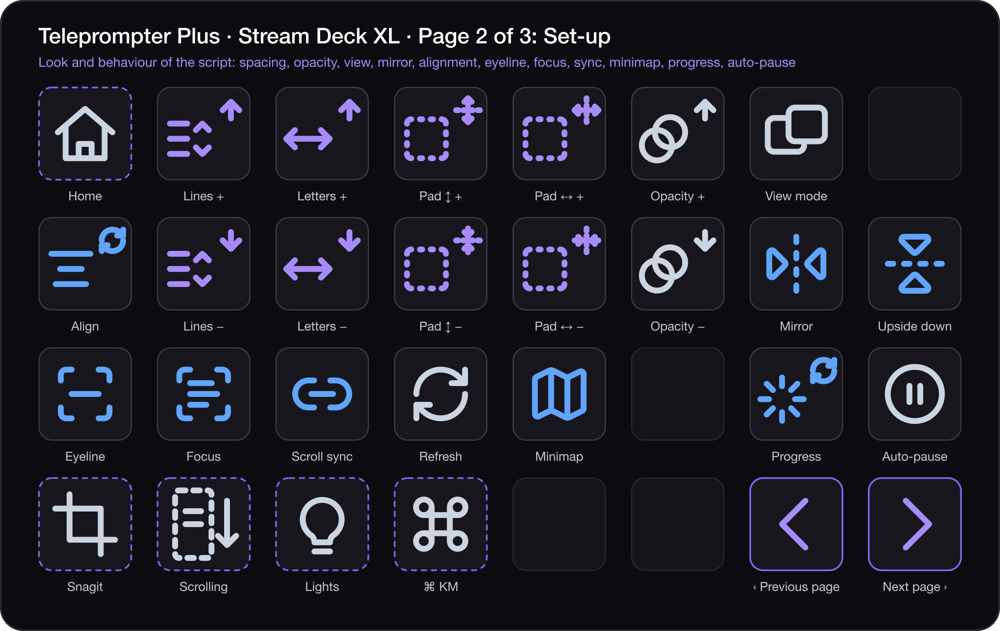
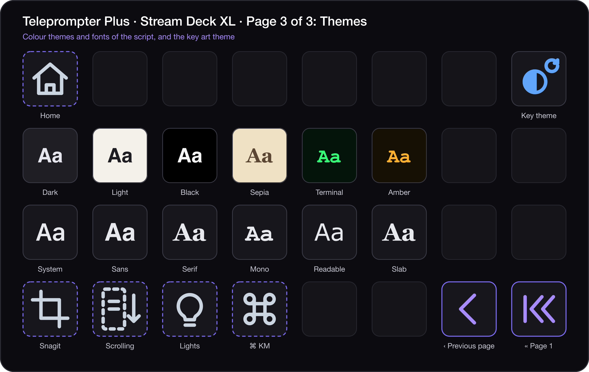
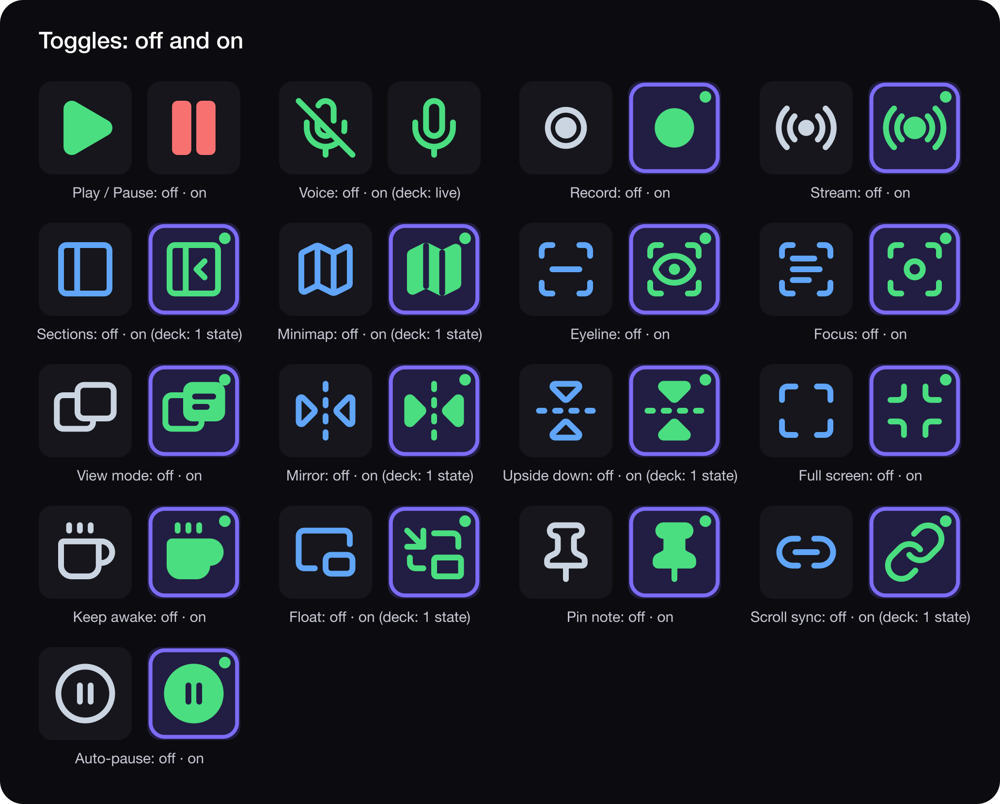

# Stream Deck XL profile

Every key of the Teleprompter Plus Stream Deck plugin on one Stream Deck XL profile: 60 actions on three pages of 32 keys. Eight keys stay put on every page: Home at R1 C1; Snagit (⌃⇧C), Snagit Scrolling (⌃⌥⇧S), Lights and the Keyboard Maestro profile key (⌘) at R4 C1 to C4; next page at R4 C8, which on the last page goes back to page 1; previous page at R4 C7 from page 2 on. Those keys keep their actions; only their pictures change, to glyphs of the same family (a house, crop marks, a dashed page with an arrow, a bulb, the command sign, chevrons). They have a dashed edge in the previews.







Page 1 holds the 26 controls you press while you rehearse and record. Page 2 holds set-up: how the script looks and behaves. Page 3 holds the colour themes and fonts, the least used. Keys that go up and down share a column, up above down. For the action behind each key and the command it sends, see [stream-deck-actions.md](stream-deck-actions.md).

## Layout

The tables below are generated from `scripts/streamdeck-profile.ts`, the one place the layout is defined. `bun scripts/streamdeck-profile.ts` rewrites them along with the icons and the previews, and `scripts/streamdeck-profile.test.ts` fails when they drift from the script or when the layout misses a key of the action catalog.

<!-- layout:start (generated by scripts/streamdeck-profile.ts, do not edit by hand) -->

### Page 1: Live

Rehearse and record: transport, sections, scrolling, speed, text size, countdown, clock, voice, OBS, window.

| Row | Col 1 | Col 2 | Col 3 | Col 4 | Col 5 | Col 6 | Col 7 | Col 8 |
|---|---|---|---|---|---|---|---|---|
| **1** | Home | Play / Pause | Countdown | Top | Prev section | Scroll up | Faster | Text + |
| **2** | Voice | Clock | Countdown + | Sections | Next section | Scroll down | Slower | Text − |
| **3** | Record | Stream | Countdown − | Float | ‹ Preset | Speed preset | Preset › | Keep awake |
| **4** | Snagit | Scrolling | Lights | ⌘ KM | Open note | Pin note | Full screen | Next page › |

| Key | Action | Purpose | Sends | Picture |
|---|---|---|---|---|
| R1 C1 | *Home (your key)* | Deck | Your key 1: Switch Profile to Stage; picture tp-home | Stream Deck key, not a T+ action |
| R1 C2 | Play/Pause | Transport | `toggle-play` | Two states: play while paused, pause while playing; follows playback |
| R1 C3 | Start Countdown | Takes and clock | `start-countdown` | One state; a press sends the command |
| R1 C4 | Reset to Top | Transport | `reset-to-top` | One state; a press sends the command |
| R1 C5 | Previous Section | Sections | `previous-section` | One state; a press sends the command |
| R1 C6 | Scroll Up | Navigation | `scroll-up` | One state; a press sends the command |
| R1 C7 | Speed Up | Speed | `increase-speed` | One state; a press sends the command |
| R1 C8 | Font Size Up | Appearance | `font-size-up` | One state; a press sends the command |
| R2 C1 | Voice Tracking | Voice | `voice-toggle` | Live picture: off, starting, listening or error, from the teleprompter |
| R2 C2 | Clock | Takes and clock | `get-state` | Live: time left against the target (or elapsed) as its title, coloured by pace |
| R2 C3 | Countdown Increase | Takes and clock | `countdown-increase` | One state; a press sends the command |
| R2 C4 | Toggle Navigation | Sections | `toggle-navigation` | One state; a press sends the command |
| R2 C5 | Next Section | Sections | `next-section` | One state; a press sends the command |
| R2 C6 | Scroll Down | Navigation | `scroll-down` | One state; a press sends the command |
| R2 C7 | Speed Down | Speed | `decrease-speed` | One state; a press sends the command |
| R2 C8 | Font Size Down | Appearance | `font-size-down` | One state; a press sends the command |
| R3 C1 | OBS Toggle Recording | Recording (OBS) | `obs-toggle-recording` | Two states, lit when on; flips on each press (the deck cannot read it back) |
| R3 C2 | OBS Toggle Streaming | Recording (OBS) | `obs-toggle-streaming` | Two states, lit when on; flips on each press (the deck cannot read it back) |
| R3 C3 | Countdown Decrease | Takes and clock | `countdown-decrease` | One state; a press sends the command |
| R3 C4 | Detach Window | Windows and note | `detach-window` | One state; a press sends the command |
| R3 C5 | Previous Speed Preset | Speed | `prev-speed-preset` | One state; a press sends the command |
| R3 C6 | Cycle Speed Preset | Speed | `cycle-speed-preset` | One state; a press sends the command |
| R3 C7 | Next Speed Preset | Speed | `next-speed-preset` | One state; a press sends the command |
| R3 C8 | Toggle Keep Awake | Windows and note | `toggle-keep-awake` | Two states, lit when on; follows the teleprompter |
| R4 C1 | *Snagit (your key)* | Deck | Copied from Stage R4 C1: Hotkey ⌃⇧C (Snagit); picture tp-capture | Stream Deck key, not a T+ action |
| R4 C2 | *Snagit Scrolling (your key)* | Deck | Hotkey ⌃⌥⇧S: the shortcut you give your Scrolling Capture preset; picture tp-capture-scroll | Stream Deck key, not a T+ action |
| R4 C3 | *Lights (your key)* | Deck | Copied from Stage R4 C2: Open light-toggle.sh; picture tp-light | Stream Deck key, not a T+ action |
| R4 C4 | *⌘ Keyboard Maestro (your key)* | Deck | Copied from Stage R4 C3: Switch Profile to KeyboardMaestro; picture tp-command | Stream Deck key, not a T+ action |
| R4 C5 | Open Active File | Windows and note | `open-active-file` | One state; a press sends the command |
| R4 C6 | Toggle Pin Note | Windows and note | `toggle-pin` | Two states, lit when on; follows the teleprompter |
| R4 C7 | Toggle Full-Screen | Windows and note | `toggle-fullscreen` | Two states, lit when on; follows the teleprompter |
| R4 C8 | *Next Page* | Deck | Navigation: Next Page (the app places it); picture tp-page-next | Stream Deck key, not a T+ action |

### Page 2: Set-up

Look and behaviour of the script: spacing, opacity, view, mirror, alignment, eyeline, focus, sync, minimap, progress, auto-pause.

| Row | Col 1 | Col 2 | Col 3 | Col 4 | Col 5 | Col 6 | Col 7 | Col 8 |
|---|---|---|---|---|---|---|---|---|
| **1** | Home | Lines + | Letters + | Pad ↕ + | Pad ↔ + | Opacity + | View mode | · |
| **2** | Align | Lines − | Letters − | Pad ↕ − | Pad ↔ − | Opacity − | Mirror | Upside down |
| **3** | Eyeline | Focus | Scroll sync | Refresh | Minimap | · | Progress | Auto-pause |
| **4** | Snagit | Scrolling | Lights | ⌘ KM | · | · | ‹ Previous page | Next page › |

| Key | Action | Purpose | Sends | Picture |
|---|---|---|---|---|
| R1 C1 | *Home (your key)* | Deck | Your key 1: Switch Profile to Stage; picture tp-home | Stream Deck key, not a T+ action |
| R1 C2 | Line Height Increase | Appearance | `line-height-increase` | One state; a press sends the command |
| R1 C3 | Letter Spacing Up | Appearance | `letter-spacing-increase` | One state; a press sends the command |
| R1 C4 | Padding Vertical Increase | Appearance | `padding-vertical-increase` | One state; a press sends the command |
| R1 C5 | Padding Horizontal Increase | Appearance | `padding-horizontal-increase` | One state; a press sends the command |
| R1 C6 | Opacity Up | Appearance | `opacity-increase` | One state; a press sends the command |
| R1 C7 | Toggle View Mode | Appearance | `toggle-view-mode` | Two states, one picture; flips on each press (the server does not report the view mode) |
| R2 C1 | Cycle Text Alignment | Appearance | `cycle-alignment` | One state; a press sends the command |
| R2 C2 | Line Height Decrease | Appearance | `line-height-decrease` | One state; a press sends the command |
| R2 C3 | Letter Spacing Down | Appearance | `letter-spacing-decrease` | One state; a press sends the command |
| R2 C4 | Padding Vertical Decrease | Appearance | `padding-vertical-decrease` | One state; a press sends the command |
| R2 C5 | Padding Horizontal Decrease | Appearance | `padding-horizontal-decrease` | One state; a press sends the command |
| R2 C6 | Opacity Down | Appearance | `opacity-decrease` | One state; a press sends the command |
| R2 C7 | Flip: Horizontal (Mirror) | Appearance | `toggle-flip-horizontal` | One state; a press sends the command |
| R2 C8 | Flip: Vertical (Upside Down) | Appearance | `toggle-flip-vertical` | One state; a press sends the command |
| R3 C1 | Toggle Eyeline | Appearance | `toggle-eyeline` | Two states, lit when on; follows the teleprompter |
| R3 C2 | Toggle Focus Mode | Appearance | `toggle-focus-mode` | Two states, lit when on; follows the teleprompter |
| R3 C3 | Scroll Sync | Windows and note | `toggle-scroll-sync` | One state; a press sends the command |
| R3 C4 | Refresh Pinned Note | Windows and note | `refresh-pinned` | One state; a press sends the command |
| R3 C5 | Minimap | Navigation | `toggle-minimap` | One state; a press sends the command |
| R3 C7 | Cycle Progress Indicator | Appearance | `cycle-progress-indicator` | One state; a press sends the command |
| R3 C8 | Toggle Auto-Pause | Transport | `toggle-auto-pause` | Two states, lit when on; follows the teleprompter |
| R4 C1 | *Snagit (your key)* | Deck | Copied from Stage R4 C1: Hotkey ⌃⇧C (Snagit); picture tp-capture | Stream Deck key, not a T+ action |
| R4 C2 | *Snagit Scrolling (your key)* | Deck | Hotkey ⌃⌥⇧S: the shortcut you give your Scrolling Capture preset; picture tp-capture-scroll | Stream Deck key, not a T+ action |
| R4 C3 | *Lights (your key)* | Deck | Copied from Stage R4 C2: Open light-toggle.sh; picture tp-light | Stream Deck key, not a T+ action |
| R4 C4 | *⌘ Keyboard Maestro (your key)* | Deck | Copied from Stage R4 C3: Switch Profile to KeyboardMaestro; picture tp-command | Stream Deck key, not a T+ action |
| R4 C7 | *Previous Page* | Deck | Navigation: Previous Page (the app places it); picture tp-page-prev | Stream Deck key, not a T+ action |
| R4 C8 | *Next Page* | Deck | Navigation: Next Page (the app places it); picture tp-page-next | Stream Deck key, not a T+ action |

### Page 3: Themes

Colour themes and fonts of the script, and the key art theme.

| Row | Col 1 | Col 2 | Col 3 | Col 4 | Col 5 | Col 6 | Col 7 | Col 8 |
|---|---|---|---|---|---|---|---|---|
| **1** | Home | · | · | · | · | · | · | Key theme |
| **2** | Dark | Light | Black | Sepia | Terminal | Amber | · | · |
| **3** | System | Sans | Serif | Mono | Readable | Slab | · | · |
| **4** | Snagit | Scrolling | Lights | ⌘ KM | · | · | ‹ Previous page | « Page 1 |

| Key | Action | Purpose | Sends | Picture |
|---|---|---|---|---|
| R1 C1 | *Home (your key)* | Deck | Your key 1: Switch Profile to Stage; picture tp-home | Stream Deck key, not a T+ action |
| R1 C8 | Cycle Theme | Deck | nothing (deck only) | Deck only: switches the key art between T+, PAI Tron and Editorial |
| R2 C1 | Color: Dark Mode | Appearance | `color-preset-dark` | One state; a press sends the command |
| R2 C2 | Color: Light Mode | Appearance | `color-preset-light` | One state; a press sends the command |
| R2 C3 | Color: Pure Black | Appearance | `color-preset-black` | One state; a press sends the command |
| R2 C4 | Color: Sepia | Appearance | `color-preset-sepia` | One state; a press sends the command |
| R2 C5 | Color: Green Terminal | Appearance | `color-preset-green` | One state; a press sends the command |
| R2 C6 | Color: Amber Retro | Appearance | `color-preset-amber` | One state; a press sends the command |
| R3 C1 | Font: System Default | Appearance | `font-preset-system` | One state; a press sends the command |
| R3 C2 | Font: Sans-serif | Appearance | `font-preset-sans` | One state; a press sends the command |
| R3 C3 | Font: Serif | Appearance | `font-preset-serif` | One state; a press sends the command |
| R3 C4 | Font: Monospace | Appearance | `font-preset-mono` | One state; a press sends the command |
| R3 C5 | Font: Readable | Appearance | `font-preset-readable` | One state; a press sends the command |
| R3 C6 | Font: Slab Serif | Appearance | `font-preset-slab` | One state; a press sends the command |
| R4 C1 | *Snagit (your key)* | Deck | Copied from Stage R4 C1: Hotkey ⌃⇧C (Snagit); picture tp-capture | Stream Deck key, not a T+ action |
| R4 C2 | *Snagit Scrolling (your key)* | Deck | Hotkey ⌃⌥⇧S: the shortcut you give your Scrolling Capture preset; picture tp-capture-scroll | Stream Deck key, not a T+ action |
| R4 C3 | *Lights (your key)* | Deck | Copied from Stage R4 C2: Open light-toggle.sh; picture tp-light | Stream Deck key, not a T+ action |
| R4 C4 | *⌘ Keyboard Maestro (your key)* | Deck | Copied from Stage R4 C3: Switch Profile to KeyboardMaestro; picture tp-command | Stream Deck key, not a T+ action |
| R4 C7 | *Previous Page* | Deck | Navigation: Previous Page (the app places it); picture tp-page-prev | Stream Deck key, not a T+ action |
| R4 C8 | *Go To Page 1* | Deck | Navigation: Go To Page, page 1; picture tp-page-first | Stream Deck key, not a T+ action |

### Every action, by purpose

| Purpose | Actions (page, row, column) |
|---|---|
| Transport (3) | Play/Pause (P1 R1 C2), Reset to Top (P1 R1 C4), Toggle Auto-Pause (P2 R3 C8) |
| Sections (3) | Previous Section (P1 R1 C5), Next Section (P1 R2 C5), Toggle Navigation (P1 R2 C4) |
| Navigation (3) | Minimap (P2 R3 C5), Scroll Up (P1 R1 C6), Scroll Down (P1 R2 C6) |
| Speed (5) | Speed Up (P1 R1 C7), Speed Down (P1 R2 C7), Cycle Speed Preset (P1 R3 C6), Next Speed Preset (P1 R3 C7), Previous Speed Preset (P1 R3 C5) |
| Takes and clock (4) | Start Countdown (P1 R1 C3), Countdown Increase (P1 R2 C3), Countdown Decrease (P1 R3 C3), Clock (P1 R2 C2) |
| Voice (1) | Voice Tracking (P1 R2 C1) |
| Recording (OBS) (2) | OBS Toggle Recording (P1 R3 C1), OBS Toggle Streaming (P1 R3 C2) |
| Appearance (31) | Font Size Up (P1 R1 C8), Font Size Down (P1 R2 C8), Line Height Increase (P2 R1 C2), Line Height Decrease (P2 R2 C2), Letter Spacing Up (P2 R1 C3), Letter Spacing Down (P2 R2 C3), Padding Vertical Increase (P2 R1 C4), Padding Vertical Decrease (P2 R2 C4), Padding Horizontal Increase (P2 R1 C5), Padding Horizontal Decrease (P2 R2 C5), Opacity Up (P2 R1 C6), Opacity Down (P2 R2 C6), Color: Dark Mode (P3 R2 C1), Color: Light Mode (P3 R2 C2), Color: Pure Black (P3 R2 C3), Color: Sepia (P3 R2 C4), Color: Green Terminal (P3 R2 C5), Color: Amber Retro (P3 R2 C6), Font: System Default (P3 R3 C1), Font: Sans-serif (P3 R3 C2), Font: Serif (P3 R3 C3), Font: Monospace (P3 R3 C4), Font: Readable (P3 R3 C5), Font: Slab Serif (P3 R3 C6), Toggle Eyeline (P2 R3 C1), Toggle Focus Mode (P2 R3 C2), Toggle View Mode (P2 R1 C7), Cycle Text Alignment (P2 R2 C1), Cycle Progress Indicator (P2 R3 C7), Flip: Horizontal (Mirror) (P2 R2 C7), Flip: Vertical (Upside Down) (P2 R2 C8) |
| Windows and note (7) | Toggle Full-Screen (P1 R4 C7), Toggle Keep Awake (P1 R3 C8), Detach Window (P1 R3 C4), Open Active File (P1 R4 C5), Toggle Pin Note (P1 R4 C6), Refresh Pinned Note (P2 R3 C4), Scroll Sync (P2 R3 C3) |
| Deck (1) | Cycle Theme (P3 R1 C8) |

<!-- layout:end -->

## Key pictures

The key art is one family, defined in [`icons/streamdeck/icons-data.js`](icons/streamdeck/icons-data.js) and exported by the script:

- a 72-unit grid, a 4.5-unit round stroke, glyphs at about two thirds of the key, on the dark key colour `#16161c`;
- a key whose action also has a toolbar button or a phone-remote button shows the same symbol: the Lucide icon named for that action in [`src/action-icons.ts`](../src/action-icons.ts), the one map the toolbar, the remote and this script read, drawn here in the family grid, stroke and colour. A key that is one step of a toolbar control (Speed Up, Countdown −) shows the control's symbol with a small arrow, plus or minus beside it. `src/action-icons.test.ts` fails when the toolbar or the remote drifts from the map, `scripts/streamdeck-profile.test.ts` when a key does;
- colour carries meaning: green starts or listens, red stops, purple is speed, size, countdown and the T+ accent, blue is navigation and layout, grey is a plain toggle;
- a key that is on (eyeline shown, focus on, pinned, full screen, keep awake, auto-pause, recording, streaming) is lit: the same glyph on a purple tint, inside the T+ accent ring `#7c6cf6`, with a green dot.



Sizes follow Elgato's plugin guidelines: key pictures at 72 × 72 px and 144 × 144 px (@2x) in `png-72/` and `png-144/`, action-list icons at 20 × 20 px and 40 × 40 px (@2x) in white on transparent in `action-list/`. The Voice and Clock keys keep the plugin's live pictures (microphone by status, clock coloured by pace); the Cycle Theme key shows the theme it is on.

## Putting the art into the deck plugin

A key shows, first, a picture you set on it in the app; then the picture the plugin sets while it runs; then the one in the plugin's manifest. The deck plugin paints every key with its theme while it runs, so this art reaches the keys through a third theme, **T+**, which becomes the default. [`icons/streamdeck/deck-plugin/tplus-theme.patch`](icons/streamdeck/deck-plugin/tplus-theme.patch) adds it to the deck plugin's `src/plugin.ts`: the T+ pictures by action folder, the lit picture for state 1 of the two-state keys, Cycle Theme stepping T+, PAI Tron, Editorial, and a picture of its own for Refresh Pinned Note, which used to share the pin. In a checkout of the deck plugin:

```sh
git apply <this repo>/docs/icons/streamdeck/deck-plugin/tplus-theme.patch
bun <this repo>/scripts/streamdeck-profile.ts --plugin-overlay .
bun run build && bun run test
```

The second line copies the PNGs into `imgs/themes/tplus/` and points the manifest's action-list icons and state images at them; it checks first that the manifest has exactly the 60 actions of the layout, and it refuses the copy installed inside the Stream Deck app. A theme saved before T+ existed moves to T+ once; a theme chosen with Cycle Theme after that is kept.

## Loading the profile

The Stream Deck app builds profiles; a `.streamDeckProfile` file is what the app's **Export** writes, and Elgato does not document its contents, so this repository does not generate one. Put the keys on in the app once, from the tables above:

1. Open the **Stream Deck** app, choose **Stream Deck XL** at the top left, then your **Teleprompter +** profile in the menu under it.
2. Right-click each key you are replacing, except key 1, and choose **Delete**. A deleted key also drops the custom picture you gave it, so the plugin's own picture shows.
3. Pin the keys every page shares. Elgato's Pinned Actions keep a key in the same position on every page and folder of a profile; a page's own key in that position wins. Right-click key 1 (Home) and turn on **Pin Action**. Then open your **Stage** profile, right-click R4 C1 (Snagit), **Copy**, come back, right-click R4 C1, **Paste**, and pin it; do the same for Lights and ⌘, pasting them on R4 C3 and R4 C4. R4 C2 (Scrolling) is a Stream Deck **Hotkey** action sending ⌃⌥⇧S: in Snagit, give the **Scrolling Capture** preset that shortcut (Presets, **+ Shortcut**). There is no separate Region key: Snagit's ⌃⇧C capture already selects a region. Copy and Paste carries the action, its settings and its picture.
4. In the action list on the right, open **Obsidian Teleprompter Plus** and drag each action onto its key of page 1.
5. Click **+** next to the page number under the keys to add pages 2 and 3. The app places **Next Page** and **Previous Page** keys by itself; move Next Page to R4 C8 on pages 1 and 2 and Previous Page to R4 C7 on pages 2 and 3. They live under **Navigation** in the action list if you need them again.
6. On page 3, put **Go To Page** (also under **Navigation**) on R4 C8, set to page 1.
7. Fill pages 2 and 3 the same way. Leave the empty keys empty: a pinned key shows only where the page has nothing.
8. Give the fixed keys their family pictures: select the key, then in the panel under the keys click its picture and choose the file from `docs/icons/streamdeck/png-144/`: `tp-home`, `tp-capture` (Snagit), `tp-light` (Lights), `tp-command` (⌘), `tp-page-next`, `tp-page-prev`, `tp-page-first`. Elgato asks for the 144 px picture when one size is given.

To pass the profile on, or to bundle it with the plugin: in the app, open **Settings** (the gear), **Profiles**, right-click the profile, **Export**, and save it as `Teleprompter Plus, Stream Deck XL.streamDeckProfile`. Elgato's profile guidelines ask for the device type in the name.

## Bundling it with the deck plugin

A Stream Deck plugin can carry profiles in its manifest. Elgato's manifest reference describes the entry; for this profile:

```json
"Profiles": [
  {
    "Name": "profiles/Teleprompter Plus, Stream Deck XL",
    "DeviceType": 2,
    "DontAutoSwitchWhenInstalled": true,
    "Readonly": false,
    "AutoInstall": true
  }
]
```

`Name` is the path of the exported file next to the manifest, without the extension. `DeviceType` 2 is the Stream Deck XL. With `AutoInstall` the app offers the profile when the plugin is installed; `DontAutoSwitchWhenInstalled` keeps it from jumping to it. `Readonly: false` lets you rearrange the keys afterwards.

Put the exported file in the deck plugin's `profiles/` folder, then `bun <this repo>/scripts/streamdeck-profile.ts --plugin-overlay . --profile "profiles/Teleprompter Plus, Stream Deck XL"` adds that entry. It refuses while the exported file is missing, so the manifest never names a profile the plugin does not carry.

## Sources

- Elgato, plugin manifest reference (`Profiles`, `DeviceType`, action icon and state image sizes): <https://docs.elgato.com/streamdeck/sdk/references/manifest/>
- Elgato, bundling and switching profiles: <https://docs.elgato.com/streamdeck/sdk/guides/profiles>
- Elgato, images and layouts (sizes, SVG for keys, white monochrome action-list icons): <https://docs.elgato.com/guidelines/streamdeck/plugins/images-and-layouts>
- Elgato, plugin guidelines (action names, icons, states): <https://docs.elgato.com/guidelines/stream-deck/plugins>
- Elgato, profile guidelines (device type in the name): <https://docs.elgato.com/guidelines/stream-deck/profiles>
- Elgato, keys (title and image precedence: your picture, then the plugin's, then the manifest's): <https://docs.elgato.com/streamdeck/sdk/guides/keys>
- Elgato help, pages (Next Page and Previous Page are placed for you and can be moved): <https://help.elgato.com/hc/en-us/articles/4410312027277-Elgato-Stream-Deck-Pages>
- Elgato, Pinned Actions (a key in the same position on every page and folder of a profile): <https://www.elgato.com/us/en/explorer/products/stream-deck/pinned-actions-stream-deck/>
